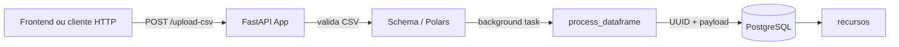

# Documentação Técnica do Microserviço de Importação

## 1. Objetivo

O `import-service` é responsável por receber arquivos CSV de importação, validar o payload, gerar identificadores para os registros e persistir os dados no PostgreSQL da plataforma Stentio.

Responsabilidades atuais:

- receber arquivos `.csv` via HTTP;
- validar extensão e tamanho do arquivo;
- converter a planilha para um DataFrame com Polars;
- normalizar colunas e gerar um identificador único por registro;
- persistir os dados na tabela `recursos` usando SQLAlchemy + AsyncPG;
- registrar logs do processamento e da conexão com o banco.

## 2. Tecnologias

| Componente | Tecnologia |
|---|---|
| Linguagem | Python 3.14 |
| Framework API | FastAPI |
| Processamento de dados | Polars |
| Banco relacional | PostgreSQL |
| ORM / acesso ao banco | SQLAlchemy + asyncpg |
| Gerenciamento de dependências | uv |
| Testes | Pytest |
| Containerização | Docker / Docker Compose |

## 3. Arquitetura geral

O serviço expõe um endpoint HTTP para upload de arquivos CSV. Quando a requisição chega, o `FastAPI` lê o arquivo, valida o formato e executa o processamento em background.



### Componentes principais

- `src/app.py`: endpoints HTTP e regras de validação de upload;
- `src/process.py`: geração de UUIDs, transformação do DataFrame e persistência no banco;
- `src/config.py`: configuração via variáveis de ambiente com `pydantic-settings`;
- `src/database.py`: engine assíncrona e sessão do SQLAlchemy;
- `src/models/recursos.py`: mapeamento da tabela `recursos`;
- `src/schemas/upload_schema.py`: schema de resposta da API.

## 4. Variáveis de ambiente

O serviço lê variáveis do arquivo `.env` do projeto ou do ambiente do processo. Os valores mais usados são:

```env
POSTGRES_HOST=postgres
POSTGRES_PORT=5432
POSTGRES_DB=stentio
POSTGRES_USER=postgres
POSTGRES_PASSWORD=postgres
DATABASE_ECHO=false
LOGGER_LEVEL=DEBUG
MAX_UPLOAD_BYTES=10485760
```

### Observações

- Quando o serviço roda dentro do Docker Compose, o host correto é geralmente `postgres` (nome do serviço na rede interna do Compose).
- Para execução local fora do Docker, normalmente usa-se `localhost`.
- O arquivo `.env.example` no diretório do serviço serve como referência para configuração local.

## 5. Como rodar localmente

### 5.1 Pré-requisitos

Antes de iniciar o projeto, certifique-se de que os itens abaixo estão instalados:

- Python 3.14+
- `uv`
- Docker e Docker Compose
- Git

### 5.2 Instalar dependências

Na raiz do projeto, dentro do diretório `import-service`:

```bash
uv sync --dev
```

### 5.3 Executar a aplicação em modo local

```bash
uv run uvicorn src.app:app --reload --host 0.0.0.0 --port 8000
```

A API ficará disponível em:

- http://localhost:8000/
- http://localhost:8000/docs

### 5.4 Subir via Docker Compose

Na raiz do repositório:

```bash
docker compose up -d --build import-service
```

O serviço expõe a porta:

- `8123:8000`

Ou seja, a API fica em:

```text
http://localhost:8123
```

## 6. Endpoints

### 6.1 Health check

```http
GET /
```

Resposta esperada:

```json
{
  "status": "Online!"
}
```

### 6.2 Upload de CSV

```http
POST /upload-csv
Content-Type: multipart/form-data
```

Campo:

- `file`: arquivo CSV

Exemplo de payload:

```csv
ativo,e-mail,nome,telefone
1,aluno@stentio.com,Ana Silva,11999999999
0,teste@stentio.com,João Souza,11888888888
```

Resposta de sucesso (`202 Accepted`):

```json
{
  "status": "Received",
  "filename": "recursos.csv",
  "size": "123",
  "lines": 2
}
```

Validações:

- exige que o arquivo tenha extensão `.csv`;
- rejeita arquivos maiores que `MAX_UPLOAD_BYTES`;
- rejeita CSVs que não tenham a estrutura esperada;
- processa o arquivo em background.

## 7. Estrutura do projeto

```text
import-service/
├── src/
│   ├── __init__.py
│   ├── app.py
│   ├── config.py
│   ├── database.py
│   ├── process.py
│   ├── models/
│   │   └── recursos.py
│   ├── schemas/
│   │   └── upload_schema.py
├── tests/
│   └── test_app.py
├── .env.example
├── Dockerfile
├── pyproject.toml
├── uv.lock
└── README.md
```

## 8. Testes

Para rodar os testes do serviço:

```bash
uv run pytest
```

Ou a partir da raiz do microserviço:

```bash
uv run --group dev pytest tests/test_app.py
```

## 9. Observações

- O processamento de importação grava registros em `recursos` e usa `email` como chave de conflito (`ON CONFLICT (email) DO NOTHING`).
- O serviço depende do PostgreSQL já estar disponível e acessível na rede correta.
- Os logs de processamento ficam no stdout do container e são úteis para diagnosticar falhas de inserção ou conexão.
- Para reiniciar o microserviço em Docker, use:

```bash
docker compose restart import-service
```

Para parar e remover os containers do projeto:

```bash
docker compose down
```
